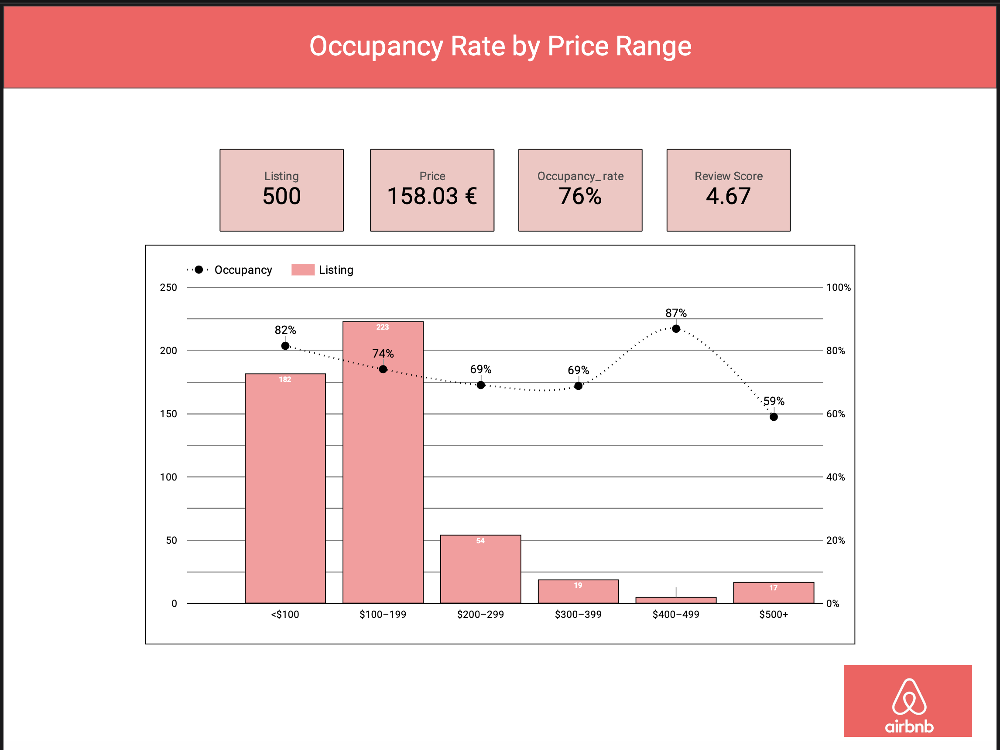

# What Drives Airbnb Occupancy?
### Airbnb Listing Performance & Occupancy Analysis

## Project Overview

Why do some Airbnb hosts achieve higher occupancy rates than others?

This project investigates the factors that may influence Airbnb listing occupancy, using listing and calendar data to explore differences in performance across room types, host responsiveness, guest reviews, pricing and monthly demand trends.

Developed as part of the Le Wagon Data Analytics Bootcamp, the project uses SQL for data analysis and Looker Studio to communicate findings through an interactive dashboard.

## Research Question

**What factors may influence Airbnb listing occupancy, and what can hosts do to improve their listing performance?**

## Project Objectives

- Understand how estimated occupancy varies across Airbnb listings.
- Investigate the relationship between room type and occupancy.
- Explore whether host response time and guest review scores may influence occupancy.
- Examine pricing as a potential factor in listing performance.
- Identify monthly occupancy trends and potential seasonal patterns.
- Translate the analysis into practical recommendations for Airbnb hosts.

## Tools & Technologies

- **SQL** — Data querying, calculations and analysis.
- **Looker Studio** — Interactive dashboard development and data visualisation.

## Methodology

The analysis uses Airbnb listing and calendar data to calculate estimated occupancy and investigate potential factors associated with listing performance.

Estimated occupancy was calculated using unavailable listing-days divided by total listing-days.

This measure is used as an occupancy proxy. Unavailable dates may include both confirmed bookings and dates blocked by hosts, so the metric should not be interpreted as a direct measure of confirmed reservations.

## Key Findings

### 1. Occupancy by Room Type

The analysis found differences in estimated average occupancy across room types:

| Room Type | Estimated Occupancy |
|---|---:|
| Shared Rooms | 83% |
| Entire Homes | 76% |
| Private Rooms | 71% |

Shared rooms recorded the highest estimated occupancy in the dataset, followed by entire homes and private rooms.

### 2. Monthly Occupancy Trends

The monthly analysis showed a steady decline in estimated occupancy between September 2022 and January 2023.

This suggests that demand was stronger earlier in the observed period, although further data would be needed to establish whether this reflects recurring seasonal patterns.

### 3. Additional Occupancy Drivers

The project also investigated host response time, guest review scores and pricing to explore how these factors may relate to listing performance.

## Recommendations for Airbnb Hosts

Based on the factors explored, the analysis provides several areas for hosts to consider:

- **Host responsiveness:** Respond promptly to guest enquiries.
- **Guest experience:** Maintain high review scores through consistent service.
- **Pricing strategy:** Review prices in relation to room type and market demand.
- **Seasonal planning:** Monitor occupancy trends and adapt pricing and availability throughout the year.

##

## Dashboard Visualisations

### Airbnb Occupancy Overview

### Average Occupancy by Room Type

### Monthly Occupancy Trends

