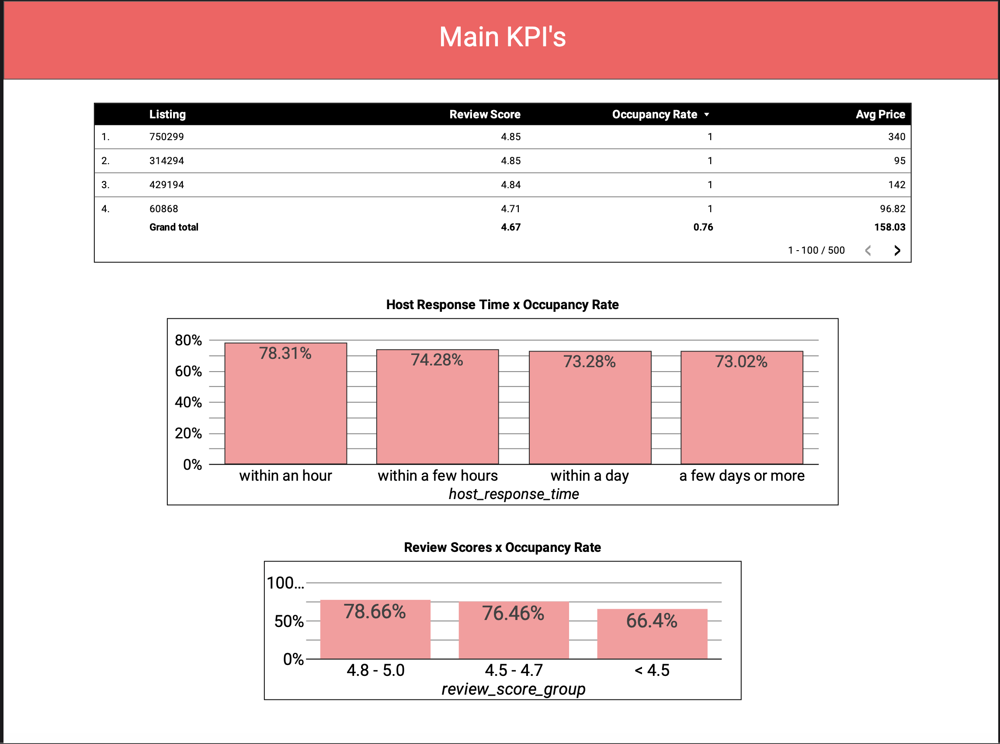
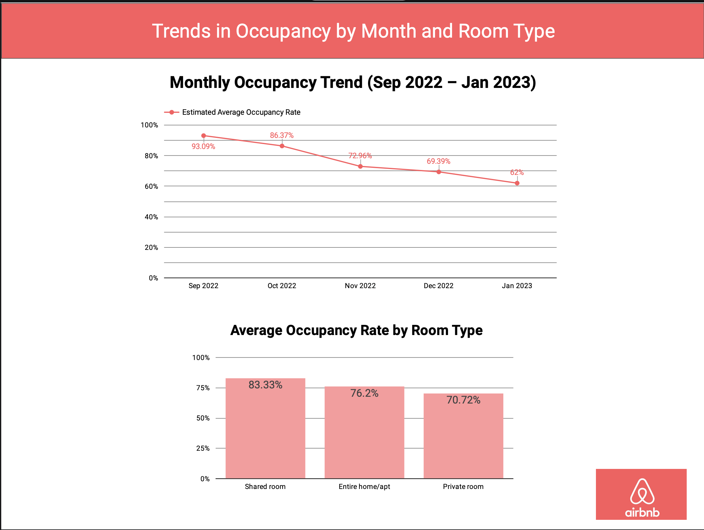

# Airbnb Occupancy & Listing Performance Analysis
### Understanding What Drives Listing Performance and Identifying Business Opportunities

## 1. Project Overview

Why do some Airbnb hosts achieve higher occupancy than others?

This project investigates the factors that may influence Airbnb listing performance, exploring the relationship between estimated occupancy, room type, pricing, guest reviews and host responsiveness.

Using Airbnb listing and calendar data, the analysis examines patterns across 500 listings to identify differences in performance, understand occupancy trends and uncover potential opportunities for hosts.

Developed as part of the Le Wagon Data Analytics Bootcamp, the project uses SQL for data analysis and Looker Studio to create an interactive dashboard that translates data into practical business insights.

## 2. Research Question

**What factors may influence Airbnb listing occupancy, and how can hosts use data to improve their listing performance?**

The analysis follows a three-part structure:

- **Beginning:** Establishing overall listing performance and estimated occupancy.
- **Middle:** Investigating potential factors influencing occupancy.
- **End:** Identifying opportunities and developing recommendations for Airbnb hosts.

## 3. Project Objectives

- Calculate and understand estimated occupancy across Airbnb listings.
- Investigate differences in occupancy by room type.
- Explore monthly occupancy trends and potential seasonality.
- Examine the relationship between listing prices and estimated occupancy.
- Investigate guest review scores and host response time as potential performance factors.
- Segment listings into performance categories to identify commercial opportunities.
- Translate analytical findings into actionable recommendations.

## 4. Tools & Technologies

- **SQL:** Data querying, transformation and analysis.
- **Looker Studio:** Interactive dashboards, KPI reporting and data visualisation.
- **Airbnb Listing Data:** Listing characteristics, pricing, room types and host information.
- **Airbnb Calendar Data:** Availability patterns and estimated occupancy calculations.

## 5. Methodology

The analysis combined Airbnb listing and calendar data to investigate occupancy patterns across 500 listings.

### Occupancy Calculation

Estimated occupancy was calculated using:

**Estimated Occupancy Rate = Unavailable Listing-Days / Total Listing-Days × 100**

This provides an estimate of listing unavailability as a proxy for occupancy. However, unavailable dates may include both confirmed bookings and dates blocked by hosts. Therefore, this metric should not be interpreted as confirmed booking occupancy.

### Performance Segmentation

Listings were classified into four opportunity segments using two dimensions: price and estimated occupancy.

- Premium Performers: High price + high occupancy.
- High Yield: Low price + high occupancy.
- Overpriced: High price + low occupancy.
- Low Performance: Low price + low occupancy.

This segmentation was used to identify different listing performance profiles and potential pricing opportunities.

## 6. Key Findings

### 6.1 Overall Listing Performance

Across the 500 Airbnb listings included in the analysis, the dashboard reported:

| Performance Indicator | Result |
|---|---:|
| Number of Listings | 500 |
| Average Estimated Occupancy | 76% |
| Average Review Score | 4.67 |
| Average Listing Price | €158.03 |

These indicators establish an overall picture of listing performance across the dataset.

### 6.2 Occupancy by Room Type

The analysis identified differences in estimated occupancy across room types:

| Room Type | Estimated Occupancy |
|---|---:|
| Shared Rooms | 83.33% |
| Entire Homes | 76.20% |
| Private Rooms | 70.72% |

Shared rooms recorded the highest estimated occupancy, followed by entire homes and private rooms.

The difference between shared rooms and private rooms was approximately 12.6 percentage points, suggesting that room type may be associated with differences in listing performance.

### 6.3 Monthly Occupancy Trends

The analysis explored changes in estimated occupancy between September 2022 and January 2023.

| Month | Estimated Occupancy |
|---|---:|
| September 2022 | 93.09% |
| October 2022 | 86.37% |
| November 2022 | 72.96% |
| December 2022 | 69.39% |
| January 2023 | 62.00% |

Estimated occupancy declined by 31.09 percentage points over the observed period.

This highlights the importance of understanding changes in demand over time when managing listing availability and pricing strategies. Further data would be required to establish whether this reflects a recurring seasonal pattern.

### 6.4 Airbnb Listing Opportunity Segmentation

To investigate the relationship between pricing and estimated occupancy, the 500 listings were classified into four performance segments.

| Opportunity Segment | Listings | Share |
|---|---:|---:|
| Premium Performers | 89 | 17.8% |
| High Yield | 236 | 47.2% |
| Overpriced | 73 | 14.6% |
| Low Performance | 102 | 20.4% |
| **Total** | **500** | **100%** |

**Segment Definitions**

- **Premium Performers:** High price and high occupancy.
- **High Yield:** Low price and high occupancy.
- **Overpriced:** High price and low occupancy.
- **Low Performance:** Low price and low occupancy.

**Key Insights**

The largest segment was High Yield, representing 47.2% of all listings. These properties combined relatively lower prices with higher estimated occupancy.

Meanwhile, 14.6% of listings were classified as Overpriced, suggesting potential opportunities to review pricing strategies and competitiveness.

This segmentation provides a practical framework for understanding listing performance and identifying potential commercial opportunities.

## 7. Business Recommendations

Based on the patterns identified in the analysis, several recommendations can be considered by Airbnb hosts:

**1. Review Pricing Strategies**

Hosts in the Overpriced segment could reassess their pricing in relation to comparable listings and estimated occupancy.

**2. Identify Opportunities for Revenue Optimisation**

High Yield listings may offer opportunities to test higher prices while monitoring occupancy performance.

**3. Maintain a High-Quality Guest Experience**

The overall average review score of 4.67 highlights the importance of guest satisfaction. Hosts should continue prioritising service quality and positive guest experiences.

**4. Improve Host Responsiveness**

Prompt communication with prospective guests is an important operational practice worth monitoring when assessing listing performance.

**5. Adapt to Changing Demand**

The decline in estimated occupancy across the observed months highlights the importance of monitoring demand patterns and adapting pricing and availability accordingly.

## 8. Dashboard & Project Files

**Interactive Looker Studio Dashboard:**

[View the Airbnb Occupancy Analysis Dashboard](https://datastudio.google.com/s/rL1FS8z81n8)

**Project Presentation:**

`Airbnb_Occupancy_Analysis.pdf`

## 9. Dashboard Visualisations

### Airbnb Occupancy Overview

### Average Occupancy by Room Type

### Monthly Occupancy Trends

## 10. Project Status

Completed — Le Wagon Data Analytics Bootcamp Project.

The project demonstrates the application of SQL, data analysis and interactive visualisation to investigate business performance, identify patterns and translate data into actionable recommendations.
